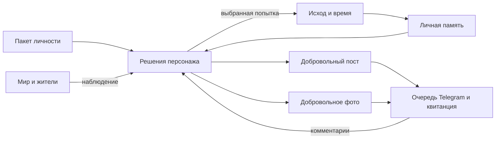

# Архитектура текущей системы

Актуально15 октября2026. [Архитектура исходного файлового шаблона](history/template-architecture.md)
сохранена отдельно; она не описывает нынешний процесс Telegram.

## Два исполнения

`engine.py`/`background.py`/`daemon.py` — более ранний личный чат, память,
самостоятельные пробуждения и панель. Его база отличается от базы мира.

`world.py`/`channel_life.py` — вымышленная жизнь и текущий самостоятельный
Telegram-канал. Не запускать старый daemon и новый цикл на одних данных.

## Цикл и источники истины

Обычный путь: `horizon → world → impulse → choice → outcome → experience → share`.
Некоторые этапы отсутствуют по настройкам/условиям. `horizon` хранит планы
жителей, `world` — доступное наблюдение. `impulse` — свободная записка героя;
`choice` переносит её без переписывания намерения. `research` добавляется
только для реального поиска отдельным инструментом с квитанциями.

`outcome` подтверждает физический вымышленный поступок и затраченное время.
`experience` — личная запись и продолжающиеся темы. После этого отдельный
выбор записи канала, затем при необходимости короткий заход к читателям.
`post/keep` не вытесняется ответом в ветке. Готовый текст не редактируется хостом.

| Данные | Что подтверждают |
| --- | --- |
| Канон | Устойчивые авторские определения, не выполненные нынешние планы |
| impulse/choice | Собственное намерение, не его результат |
| world/outcome | Наблюдаемое/состоявшееся в вымышленном мире |
| experience | Отношение, личный вывод и незаконченные темы |
| post/comment | Слова говорящего, не патч физического мира |
| Telegram receipt | Настоящую отправку в конкретное место |
| Research receipt | Фактически выполненный инструментальный поиск |

## Хранение и изоляция

SQLite хранит циклы, вызовы, события, сущности, истории, связи, личные заметки,
намерения, читателей, задания доставки и ремонты. Этап помечается начатым
перед вызовом. Новое состояние принимается транзакционно после проверки.
У мира один владелец и общий `revision`; второй процесс блокируется.
Во время ожидания уже сохранённого outcome разрешён отдельный служебный
речевой цикл комментариев. Он не меняет физическое состояние и время;
будущий исход скрыт из входа героя. Только его изменения общения могут
последовательно обновить revision ожидающей личной записи.

`actor_view(actor_id)` возвращает только известные сущности/истории,
наблюдаемые события и собственные личные записи. `world_note` не попадает
персонажу. Канон мира раздельный по actor_id; планы NPC не становятся тайным
знанием героя. Короткий `director_signal` может подсказать миру интерес
участника, не давая NPC телепатию. Имена владельцев не задают иерархию отношений.

Читатели запоминаются по аккаунту, с впечатлениями и основаниями. Анонимный
автор остаётся анонимным голосом. Короткие ссылки на источники выбираются из
допустимой схемы; хост проверяет существование и область. Это не автоматическое
доказательство истинности любой интерпретации. Принятое обещание привязывается
к точным собственным словам; завершение записи требует доставки.

## Время, публикации и инструменты

В лаборатории время виртуальное. В живом канале оно привязано к московским
часам: герой ожидает фактическую длительность рассчитанного дела перед
личной реакцией/публикацией результата. UI может заранее показывать уже
рассчитанный исход; отдельного события прогресса во время ожидания ещё нет.

Ориентир длины эпизода, пауза между ними, обстоятельства, разнообразие,
внимание и готовность делиться настраиваются. Это не принудительный график
постов. Чат не переносит бесконечно срок собственных дел.

Транспорт модели — изолированные процессы Codex app-server. Обычные роли
не имеют инструментов; research имеет только нативный web. Фото выбирает
сам герой, отдельный нативный инструмент создаёт файл с проверкой квитанций.
Визуальные референсы принадлежат участнику/сущности, новое фото не заменяется
старым по ID предмета. Telegram-права и токен остаются вне промпта.

## Остановка и восстановление

Ошибочный/прерванный этап и неопределённая доставка не повторяются автоматически.
Рабочий результат сохраняется. Для некоторых ошибок есть явный разбор
того же сохранённого текста под исправленным контрактом без нового вызова;
failed и usage остаются в истории. Отсутствие поста после неопределённой
доставки должен явно подтвердить владелец, а не угадать модель.

Caffeinate на Mac относится к процессу, а не к глобальным настройкам питания.
Данные и секреты находятся в игнорируемой локальной папке. Блокировка экрана
допустима; потеря питания/сети всё равно может остановить исполнение.

## Общий хост двух участников

`shared_host.py` загружает два профиля и два подключения, а общий
`SharedScheduler` последовательно вызывает роли каждого. Выбор сохраняет
реалистичную длительность; цикл `waiting` ждёт собственного срока без
вычисленного outcome. В срок результат впервые разрешается на свежем мире,
без второго прибавления времени. Глобальный revision и один owner сохранены.

`peer_deliveries` хранит однократные слова и наблюдения получателя;
`peer_jobs` — исходящие решения и квитанции, `peer_invitations` — предложение
и собственный ответ адресата, `peer_positions` — подтверждённое присутствие.
Свои слова и личный опыт хранятся отдельно. Доставленные посты могут быть
прочитаны вторым; внешние комментарии идут ботом автора в проверенную ветку
другого канала. Их чтение вторым героем не зависит от Telegram bot-to-bot mode.

Пауза/ошибка разделены по актёрам, общий пульт доступен локально. Обычные
посты, читатели, намерения, фото и настройки используют прежние механизмы
с actor-scoped очередями и отдельными каталогами визуальной памяти.
[Миграция, команды, проверки и границы](shared-life.md).
